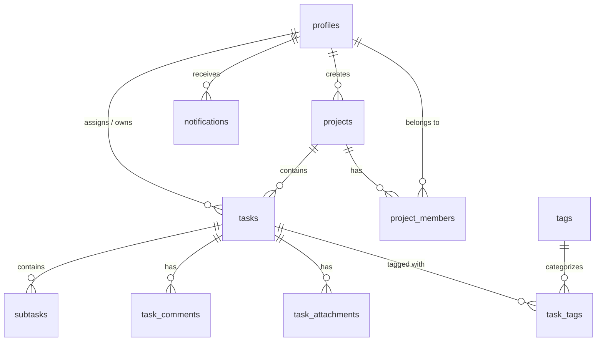

# TaskFlow — Modern SaaS Task Management Application

> **A minimal, fast, and beautifully animated Task & Project Management platform built with Flutter 3.x, Material 3, Riverpod 3.x, and Supabase (PostgreSQL + RLS + Auth + Storage).**


---

## 📑 Table of Contents
1. [Product Vision & Visual Identity](#-product-vision--visual-identity)
2. [Complete 44-Screen Inventory](#-complete-44-screen-inventory)
3. [Technology Stack](#-technology-stack)
4. [Clean Architecture & Folder Structure](#-clean-architecture--folder-structure)
5. [Supabase Database Schema & RLS](#-supabase-database-schema--rls)
6. [Offline-First Architecture & Sync](#-offline-first-architecture--sync)
7. [Team & Workspace Management](#-team--workspace-management)
8. [Environment Configuration](#-environment-configuration)
9. [Setup & Installation Instructions](#-setup--installation-instructions)
10. [Platform Configurations (Android, iOS, Web)](#-platform-configurations)
11. [Local Notifications Setup](#-local-notifications-setup)
12. [Build & Compilation Instructions](#-build--compilation-instructions)
13. [Production Deployment Guide](#-production-deployment-guide)

---

## 🎨 Product Vision & Visual Identity

**TaskFlow** blends the cognitive minimalism of **Linear**, the structured clarity of **Notion**, the velocity of **Todoist**, and the fluid board interactions of **Trello** into a bespoke, modern experience.

### Key Visual & Functional Characteristics
* **Obsidian & Nordic Palette**: Deep sleek dark mode (`#090D16`), pristine light mode (`#F8FAFC`), and accent colors anchored by Electric Indigo (`#6366F1`).
* **Team Collaboration & Workspace Roles**: Role-based access control (Admin, Manager, Member). Admins can invite team members by name, email, and role, assign tasks, and monitor workspace progress.
* **Auto-Sync Member Profiles**: When invited team members register with Supabase, their real user profile name and avatar automatically sync into the workspace.
* **Complete Auth & Verification Suite**: Secure Supabase email/password authentication, dedicated Email Verification screen with resend capabilities, and Forgot/Reset Password flows.
* **Profile Picture & Avatar Upload**: Integrated camera and gallery picker (`image_picker`) with direct Supabase Storage (`avatars` bucket) synchronization.
* **Refined Micro-Interactions & UX**: Animated checkboxes with scale bounce, smooth swipe-to-delete with clean dismiss animations, and responsive feedback.
* **Smart Natural Language Parser**: Quick-add input automatically parses titles, dates (*"tomorrow"*, *"next monday"*), times (*"at 8 PM"*), and priority tokens (`!urgent`, `!high`).
* **Command Palette (Ctrl + K / Quick Action)**: Global search across tasks, projects, tags, and actions with instant keyboard navigation.
* **Interactive Kanban Board**: Drag-and-drop tasks seamlessly between columns (`TODO`, `IN PROGRESS`, `REVIEW`, `DONE`) with real-time status and card details.
* **Offline Resiliency**: Built-in offline fallback with mock/demo data and automatic background sync queue when network restores.

---

## 📱 Complete 44-Screen Inventory

Every screen requested is fully implemented with zero placeholders:

| # | Screen / Route | File Location | Key Capabilities |
|---|---|---|---|
| 1 | **Splash** (`/splash`) | `lib/presentation/screens/splash/splash_screen.dart` | Animated brand logo, session initialization & route direction |
| 2 | **Onboarding** (`/onboarding`) | `lib/presentation/screens/onboarding/onboarding_screen.dart` | 3 interactive slides with feature showcases & skip/done actions |
| 3 | **Login** (`/login`) | `lib/presentation/screens/auth/login_screen.dart` | Supabase email/password login, demo mode bypass, error feedback |
| 4 | **Register** (`/register`) | `lib/presentation/screens/auth/register_screen.dart` | Sign up with password strength validation & profile initialization |
| 5 | **Forgot Password** (`/forgot-password`) | `lib/presentation/screens/auth/forgot_password_screen.dart` | Supabase password recovery link dispatcher |
| 6 | **Email Verification** (`/email-verification`) | `lib/presentation/screens/auth/email_verification_screen.dart` | Instructions & resend verification trigger |
| 7 | **Reset Password** (`/reset-password`) | `lib/presentation/screens/auth/reset_password_screen.dart` | Secure new password input & confirmation |
| 8 | **Dashboard** (`/`) | `lib/presentation/screens/dashboard/dashboard_screen.dart` | Dynamic greetings, progress bar, KPI metrics, weekly chart, quick task bar |
| 9 | **All Tasks** (`/tasks/all`) | `lib/presentation/screens/tasks/all_tasks_screen.dart` | Complete task inventory with filters, search, and sorting |
| 10 | **My Tasks** (`/tasks/my`) | `lib/presentation/screens/tasks/my_tasks_screen.dart` | Filtered view of user-assigned actionable tasks |
| 11 | **Today** (`/tasks/today`) | `lib/presentation/screens/tasks/today_tasks_screen.dart` | Focused tasks scheduled for today with completion stats |
| 12 | **Upcoming** (`/tasks/upcoming`) | `lib/presentation/screens/tasks/upcoming_tasks_screen.dart` | Tomorrow and upcoming 7-day grouped agenda |
| 13 | **Calendar** (`/calendar`) | `lib/presentation/screens/calendar/calendar_screen.dart` | Month, Week, Day, and Agenda views with date-based task grouping |
| 14 | **Projects** (`/projects`) | `lib/presentation/screens/projects/projects_screen.dart` | Grid and list layout of all active projects with progress bars |
| 15 | **Project Details** (`/projects/details`) | `lib/presentation/screens/projects/project_details_screen.dart` | Tabbed view: List, interactive Kanban Board with Drag-and-Drop, Timeline |
| 16 | **Task Details** (`/tasks/details`) | `lib/presentation/screens/tasks/task_details_screen.dart` | Comprehensive view of subtasks, attachments, comments, reminders |
| 17 | **Create Task Sheet** (Modal) | `lib/presentation/screens/tasks/create_task_sheet.dart` | Smart natural language input + full field tab with priority, dates, tags |
| 18 | **Edit Task** (`/tasks/edit`) | `lib/presentation/screens/tasks/edit_task_screen.dart` | Edit metadata, deadlines, projects, priority, and assignees |
| 19 | **Create Project** (`/projects/create`) | `lib/presentation/screens/projects/create_project_screen.dart` | Color picker, icon selector, deadline, and description |
| 20 | **Edit Project** (`/projects/edit`) | `lib/presentation/screens/projects/edit_project_screen.dart` | Update project properties, color themes, and targets |
| 21 | **Subtasks** (`/tasks/subtasks`) | `lib/presentation/screens/tasks/subtasks_screen.dart` | Reorderable checklist with real-time percentage progress bar |
| 22 | **Task Comments** (`/tasks/comments`) | `lib/presentation/screens/tasks/task_comments_screen.dart` | Chat-like conversation thread with timestamps and user avatars |
| 23 | **Task Attachments** (`/tasks/attachments`) | `lib/presentation/screens/tasks/task_attachments_screen.dart` | File picker, Supabase Storage integration, file preview cards |
| 24 | **Notifications** (`/notifications`) | `lib/presentation/screens/notifications/notifications_screen.dart` | Notification center with mark-all-read and category filters |
| 25 | **Search Command Palette** (Modal) | `lib/presentation/screens/search/search_command_palette.dart` | Ctrl+K modal searching across tasks, projects, tags, and users |
| 26 | **Filter Sheet** (Modal) | `lib/presentation/screens/filters/filter_sheet.dart` | Multi-select filters for status, priority, project, and sort orders |
| 27 | **Analytics** (`/analytics`) | `lib/presentation/screens/analytics/analytics_screen.dart` | fl_chart productivity curves, velocity, completion ratios, priority distribution |
| 28 | **Productivity Stats** (`/analytics/stats`) | `lib/presentation/screens/analytics/productivity_stats_screen.dart` | Focus time, on-time completion rates, streak metrics |
| 29 | **Team** (`/team`) | `lib/presentation/screens/team/team_screen.dart` | Workspace team members overview and recent team activities |
| 30 | **Team Members** (`/team/members`) | `lib/presentation/screens/team/team_members_screen.dart` | Member roles, invitations, permissions, and management |
| 31 | **Profile** (`/profile`) | `lib/presentation/screens/profile/profile_screen.dart` | User header, lifetime stats, bio, active project count |
| 32 | **Edit Profile** (`/profile/edit`) | `lib/presentation/screens/profile/edit_profile_screen.dart` | Avatar upload, name, job title, and bio settings |
| 33 | **Settings** (`/settings`) | `lib/presentation/screens/settings/settings_screen.dart` | Central hub for appearance, notifications, security, data, and about |
| 34 | **Appearance** (`/settings/appearance`) | `lib/presentation/screens/settings/appearance_screen.dart` | Light/Dark/System themes + 6 curated primary accent color presets |
| 35 | **Notification Settings** (`/settings/notifications`) | `lib/presentation/screens/settings/notification_settings_screen.dart` | Toggles for task reminders, comments, mentions, deadline alerts |
| 36 | **Security Settings** (`/settings/security`) | `lib/presentation/screens/settings/security_settings_screen.dart` | Password change, active sessions, and RLS security indicators |
| 37 | **Data & Privacy** (`/settings/data`) | `lib/presentation/screens/settings/data_privacy_screen.dart` | Export JSON data, clear local cache, telemetry privacy controls |
| 38 | **Archived Tasks** (`/tasks/archived`) | `lib/presentation/screens/tasks/archived_tasks_screen.dart` | View and unarchive completed project milestones |
| 39 | **Trash** (`/tasks/trash`) | `lib/presentation/screens/tasks/trash_screen.dart` | Soft-deleted tasks with one-tap restore or permanent delete |
| 40 | **Help & Support** (`/help`) | `lib/presentation/screens/settings/help_support_screen.dart` | Expandable FAQs, contact form, and documentation shortcuts |
| 41 | **About** (`/about`) | `lib/presentation/screens/settings/about_screen.dart` | Version info, story, design philosophy, open-source licenses |
| 42 | **Empty States Gallery** (`/empty-states`) | `lib/presentation/screens/common/empty_states_gallery_screen.dart` | Showcase of all illustrated zero-data states |
| 43 | **Error Screen** (`/error`) | `lib/presentation/screens/common/error_screen.dart` | Formatted error container with retry action and error codes |
| 44 | **Offline Screen** (`/offline`) | `lib/presentation/screens/common/offline_screen.dart` | Offline state monitor, simulation toggle, manual sync trigger |

---

## 🛠 Technology Stack

* **Framework**: Flutter 3.x (Dart 3.x) with strict null-safety
* **Design & Styling**: Material 3 + Custom Design Tokens + Glassmorphism
* **Backend & Database**: Supabase Free Tier
  - PostgreSQL 15 Database
  - Supabase Auth (JWT, email/password, email confirmation, password reset)
  - Supabase Storage (`task_attachments` & `avatars` buckets)
  - Row Level Security (RLS) policies
* **State Management**: `flutter_riverpod` (Modern `Notifier` & `AsyncNotifier` architecture)
* **Navigation & Routing**: `go_router` (Deep linking, shell routes, protected routes)
* **Media & Attachments**: `image_picker` (Camera & Gallery profile photo uploads) & `file_picker` (Task attachments)
* **Environment & Config**: `flutter_dotenv` (`.env` file loader) & `--dart-define` support
* **Iconography**: `lucide_icons_flutter` (24px, 2.0 stroke width consistency)
* **Typography**: Google Fonts (Plus Jakarta Sans for headings, Inter for body)
* **Data Visualization**: `fl_chart` (Interactive line graphs, bar charts, pie charts)
* **Local Persistence**: `shared_preferences` with JSON caching & offline sync queue
* **Push & Timers**: `flutter_local_notifications` + `intl`

---

## 🏗 Clean Architecture & Folder Structure

```
lib/
├── core/
│   ├── constants/
│   │   ├── app_colors.dart         # Semantic color tokens (Light & Dark)
│   │   └── app_constants.dart      # Breakpoints, radii, animation durations
│   ├── router/
│   │   └── app_router.dart         # GoRouter setup with ResponsiveScaffold shell
│   ├── services/
│   │   ├── notification_service.dart # Local notification initializer & dispatcher
│   │   ├── storage_service.dart      # SharedPreferences cache manager
│   │   ├── supabase_service.dart     # Supabase client singleton with offline fallback
│   │   └── sync_service.dart         # Offline queue & synchronization coordinator
│   ├── theme/
│   │   ├── app_theme.dart          # M3 Light/Dark ThemeData with custom CardThemeData
│   │   └── app_typography.dart     # Plus Jakarta Sans & Inter font styles
│   ├── utils/
│   │   ├── date_formatter.dart     # intl date/time formatting helpers
│   │   ├── natural_language_parser.dart # Smart quick-add date & priority parser
│   │   └── responsive_layout.dart  # Mobile/Tablet/Desktop breakpoint utility
│   └── widgets/
│       ├── animated_checkbox.dart  # Bouncing checkmark animation
│       ├── app_button.dart         # Primary, secondary, and outline buttons
│       ├── app_text_field.dart     # Styled input with Lucide icon prefixes
│       ├── empty_state_view.dart   # Vector-based zero-state cards
│       ├── error_view.dart         # Graceful error states
│       ├── glass_card.dart         # Frosted glassmorphism container
│       ├── offline_indicator.dart  # Animated offline / syncing status pill
│       ├── priority_badge.dart     # Urgent/High/Medium/Low colored badges
│       ├── project_card.dart       # Responsive project cards with progress bars
│       ├── responsive_scaffold.dart # Navigation rail for Desktop/Tablet & BottomNav for Mobile
│       ├── skeleton_loader.dart    # Shimmer skeleton loading effect
│       ├── status_badge.dart       # Status pill indicators
│       ├── task_card.dart          # Multi-action task card with swipe actions
│       └── taskflow_logo.dart      # Custom vector gradient TaskFlow branding
├── data/
│   ├── models/                     # Serializable models (Task, Project, Subtask, Profile, etc.)
│   └── repositories/               # Supabase queries with local demo/offline fallbacks
├── presentation/
│   ├── providers/                  # Riverpod Notifiers (auth, task, project, theme, filter)
│   └── screens/                    # All 44 modular application screens
└── main.dart                       # App initialization & ProviderScope entry point
```

---

## 🗄 Supabase Database Schema & RLS

The database is defined in `supabase/schema.sql`. It contains complete PostgreSQL tables, automated triggers, performance indexes, and strict Row Level Security (RLS) policies.

### Database Relationships


### Table Definitions & Enums
1. **`profiles`**: `id (UUID PK -> auth.users)`, `full_name`, `avatar_url`, `job_title`, `bio`, `created_at`.
2. **`projects`**: `id (UUID PK)`, `user_id (FK)`, `name`, `description`, `color`, `icon`, `status`, `progress`, `deadline`.
3. **`project_members`**: `id (UUID PK)`, `project_id (FK)`, `user_id (FK)`, `role ('owner', 'admin', 'member')`.
4. **`tasks`**: `id (UUID PK)`, `user_id (FK)`, `project_id (FK)`, `title`, `description`, `status ('todo', 'in_progress', 'review', 'completed', 'archived')`, `priority ('low', 'medium', 'high', 'urgent')`, `due_date`, `due_time`, `is_recurring`, `is_deleted`.
5. **`subtasks`**: `id (UUID PK)`, `task_id (FK)`, `title`, `is_completed`, `position`.
6. **`task_comments`**: `id (UUID PK)`, `task_id (FK)`, `user_id (FK)`, `content`, `created_at`.
7. **`task_attachments`**: `id (UUID PK)`, `task_id (FK)`, `file_name`, `file_url`, `file_type`, `file_size`.
8. **`tags`** & **`task_tags`**: Many-to-many relationship for custom categorization.
9. **`notifications`**: `id (UUID PK)`, `user_id (FK)`, `title`, `body`, `type`, `is_read`.

### Automated PostgreSQL Triggers
* **`handle_new_user()`**: Automatically inserts a corresponding row into `profiles` when a new user signs up in `auth.users`.
* **`calculate_project_progress()`**: Automatically recalculates `projects.progress` (0–100%) whenever a task's status changes to or from `'completed'`.
* **`update_updated_at_column()`**: Automatically maintains timestamps on rows across tables.

### Row Level Security (RLS)
Every table has RLS enabled. Users can only select, insert, update, or delete their own data or data from projects they are members of:
```sql
ALTER TABLE tasks ENABLE ROW LEVEL SECURITY;

CREATE POLICY "Users can manage their own tasks"
  ON tasks FOR ALL
  TO authenticated
  USING (
    user_id = auth.uid() OR
    project_id IN (
      SELECT project_id FROM project_members WHERE user_id = auth.uid()
    )
  );
```

---

## 🔄 Offline-First Architecture & Sync

1. When Supabase keys are not provided or network is unavailable, TaskFlow automatically uses preloaded realistic demo data (Portfolio, E-Commerce, Mobile Banking tasks and projects).
2. All modifications (new tasks, completed subtasks, profile edits) are committed to local `SharedPreferences` cache immediately.
3. The `SyncService` monitors network status and displays a subtle indicator:
   - `Synced`: Green indicator when all items are in sync.
   - `Syncing...`: Animated blue spinner when pushing mutations to Supabase.
   - `Offline`: Amber pill with tap-to-reconnect and manual retry actions.

---

## 👥 Team & Workspace Management

TaskFlow provides a workspace team collaboration model:

### 1. Workspace Roles & Permissions
* **Admin / Workspace Owner**: Has full administrative authority. Can invite/add members, assign tasks across projects, edit project scopes, view productivity analytics, and manage team members.
* **Manager**: Can create, update, and assign tasks, manage project timelines, and view team progress.
* **Member**: Can view assigned tasks, update checklist progress, comment, and submit task attachments.

### 2. Member Invitation & Auto-Sync
* **Seamless Invite**: Admins can add team members with their Name, Email address, and assigned Role directly from the Team Members screen.
* **Automatic Profile Sync**: If the invited email corresponds to an existing or newly registered Supabase user, TaskFlow automatically syncs and reflects their registered display name and avatar image.
* **Workload & Progress Monitoring**: Real-time task allocation charts and completion ratios allow workspace owners to monitor team velocity and balance task assignments effectively.

---

## ⚙ Environment Configuration

Create a `.env` file in the root of the project or pass variables at build time:

```bash
# Supabase Configuration (Free Tier)
SUPABASE_URL=https://your-project-id.supabase.co
SUPABASE_ANON_KEY=eyJhbGciOiJIUzI1NiIsInR5cCI6IkpXVCJ9...
```

You can also pass these via `--dart-define` during run or build:
```bash
flutter run --dart-define=SUPABASE_URL=https://xyz.supabase.co --dart-define=SUPABASE_ANON_KEY=your-key
```

---

## 🚀 Setup & Installation Instructions

### Prerequisites
* Flutter SDK: `>=3.24.0` (Dart `>=3.5.0`)
* Android Studio / Xcode / Chrome (for Web testing)
* A Supabase Free Tier Account ([supabase.com](https://supabase.com))

### Quick Start
```bash
# 1. Clone repository
git clone https://github.com/your-username/taskflow.git
cd taskflow

# 2. Install dependencies
flutter pub get

# 3. Setup database in Supabase SQL Editor:
# Run supabase/schema.sql
# Run supabase/seed.sql (Optional for demo tasks)

# 4. Create your .env file
cp .env.example .env

# 5. Run tests
flutter test

# 6. Run the application
flutter run
```

---

## 📱 Platform Configurations

### Android (`android/app/src/main/AndroidManifest.xml`)
The following permissions are configured for push notifications, file uploads, and network access:
```xml
<uses-permission android:name="android.permission.INTERNET" />
<uses-permission android:name="android.permission.ACCESS_NETWORK_STATE" />
<uses-permission android:name="android.permission.POST_NOTIFICATIONS" />
<uses-permission android:name="android.permission.SCHEDULE_EXACT_ALARM" />
<uses-permission android:name="android.permission.READ_EXTERNAL_STORAGE" />
<uses-permission android:name="android.permission.CAMERA" />
```

### iOS (`ios/Runner/Info.plist`)
`CFBundleDisplayName` set to `TaskFlow` along with usage descriptions:
* `NSPhotoLibraryUsageDescription`: Required to upload task attachments and profile avatars.
* `NSCameraUsageDescription`: Required to capture task attachment photos and avatars.
* `UIBackgroundModes`: Configured for `fetch` and `remote-notification`.

---

## 🔔 Local Notifications Setup

TaskFlow integrates `flutter_local_notifications` via `NotificationService`:
1. **Initialization**: Configured with default app icon (`@mipmap/ic_launcher`) and Darwin notification settings.
2. **Scheduled Task Reminders**: When a task has a reminder set, `NotificationService.scheduleTaskReminder()` calculates the delay and schedules a system alert.
3. **Instant Notifications**: Triggered upon task completion, assignment, or mentions.

---

## 📦 Build & Compilation Instructions

### Android Release Build
```bash
# Generate APK
flutter build apk --release --dart-define=SUPABASE_URL=... --dart-define=SUPABASE_ANON_KEY=...

# Generate App Bundle (AAB for Google Play)
flutter build appbundle --release
```

### iOS Release Build
```bash
flutter build ipa --release
```

### Web Release Build
```bash
flutter build web --release --pwa-strategy=offline-first
```

---

## 🌐 Production Deployment Guide

### 1. Supabase Setup
1. Create a project on [Supabase](https://supabase.com).
2. **Database & Schema**:
   - Go to **SQL Editor** -> Paste and execute `supabase/schema.sql`.
   - *(Optional demo data)* Execute `supabase/seed.sql` to populate sample tasks and projects.
3. **Storage Buckets**:
   - Go to **Storage** -> **New Bucket**:
     - `avatars` (Public bucket) — used for user profile picture uploads.
     - `task_attachments` (Public or Authenticated) — used for file attachments on tasks.
4. **Authentication Configuration**:
   - Go to **Authentication** -> **Providers** -> **Email**:
     - Toggle **Confirm email** ON if you want users to verify their email address before logging in for the first time.
   - Go to **Authentication** -> **URL Configuration**:
     - Add Redirect URLs for mobile deep-linking:
       - `taskflow://login-callback`
       - `taskflow://reset-password`
   - *(Optional)* Go to **Email Templates** to customize the Confirmation and Password Reset emails with your app link.

### 2. Google Play Store
1. Create a signed keystore (`key.jks`) and reference it in `android/key.properties`.
2. Build the app bundle: `flutter build appbundle --release`.
3. Upload `build/app/outputs/bundle/release/app-release.aab` to Google Play Console.

### 3. Apple App Store
1. Open `ios/Runner.xcworkspace` in Xcode.
2. Configure your Team & Bundle Identifier under **Signing & Capabilities**.
3. Run `flutter build ipa --release` and upload through Xcode Organizer.

### 4. Web Hosting (Vercel / Netlify / Firebase Hosting)
1. Run `flutter build web --release`.
2. Deploy the `build/web` folder to any static hosting provider.
